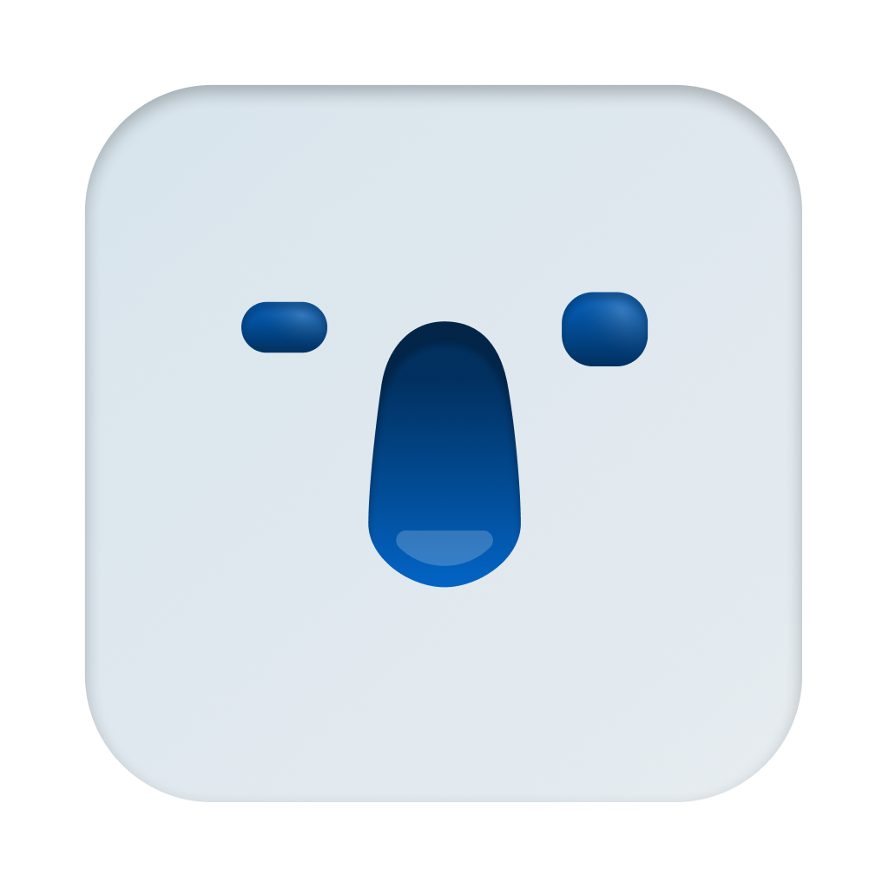

<div align="center">



[](https://github.com/Roho7/yapn/releases/latest)
[](https://github.com/Roho7/yapn/releases)

[](https://github.com/Roho7/yapn)

<h1>Yapn</h1>

A super lightweight context-aware dictation app for Mac.

Built for agentic workflows.

[Download](#download) · [Features](#features) · [Build](#build-from-source)

</div>

---

Yapn is dictation app that is fully local, super fast and understand developer lingo. Hold Right Option. Say what you mean. Let go.

What lands at your cursor is what you *meant* to write, in whatever app you're in.

No cloud. Your voice never leaves your Mac.

## Download

| Platform | File |
|---|---|
| macOS 14+, Apple Silicon | [Yapn.zip](https://github.com/Roho7/yapn/releases/latest)* |

\*Not notarized by Apple yet, so macOS blocks the first open. Go to System Settings > Privacy & Security and click **Open Anyway**.

1. Unzip it and drag `Yapn.app` to Applications.
2. Open it. The first launch downloads a ~450 MB speech model.
3. Allow Microphone, then turn Yapn on under Privacy & Security > Accessibility. Reopen it once.

## Features

### It listens like a person

Nobody talks in perfect sentences. Yapn doesn't expect you to.

> "Uh, the the build is slow."

```
The build is slow
```

### It speaks developer

Say the symbols. Get the code.

> "Run slash code review on this branch."

```
run /code-review on this branch
```

> "Open src slash lib slash auth dot ts."

```
open src/lib/auth.ts
```

Skill names are matched against the skills you actually have installed. Yapn never invents one.

### It knows where you are

The same sentence means different things in different places. Yapn knows the difference.

**In a terminal** (including the one inside VS Code and Cursor), it writes a command. One line. It never presses Enter.

> "npm test with the verbose flag."

```
npm test --verbose
```

> "docker compose up dash d."

```
docker compose up -d
```

> "Git commit with message fix login bug."

```
git commit -m "fix login bug"
```

*That last one needs Apple Intelligence.*

**On LinkedIn and in Mail**, it writes like you meant to be taken seriously.

> "Honestly this was kind of the best talk I've seen this year."

```
This was the best talk I've seen this year.
```

**In Claude Code**, it writes prompts, not commands: your words, tidied, with `/skills` spelled right.

### Say a list. Get a list.

> "I need three things. First, the API, second, the docs, and third, the tests."

```
I need three things:
1. The API
2. The docs
3. The tests
```

> "Shopping list, bullet point oat milk, next bullet eggs."

```
Shopping list:
- Oat milk
- Eggs
```

### Change your mind. It keeps up.

*Needs Apple Intelligence. [See below.](#make-it-smarter-with-apple-intelligence)*

> "I need three things for my grocery list. Actually no, four things for my grocery list."

```
I need four things for my grocery list.
```

> "Let's meet Monday, no wait, Tuesday."

```
Let's meet Tuesday.
```

### Tasteful and Minimal

Yapn lives in your notch. Grows out when you're speaking to it, disappears once you're done, with satisfying animations. 

## Make it smarter with Apple Intelligence

Out of the box, Yapn removes fillers and stutters, turns spoken symbols into code, and builds lists. That's all rules, and it works on any Mac.

Turn on Apple Intelligence and it gets a lot smarter. It catches self-corrections, cleans up long stretches of hesitation, polishes what you write on LinkedIn and in Mail, and turns spoken commands into real ones.

1. You need a Mac with Apple Silicon running macOS 26.
2. Open System Settings > Apple Intelligence & Siri and turn on Apple Intelligence. The first time, it downloads its model.
3. Then switch Yapn's smart cleanup on:

```
defaults write dev.roho.yapn llmCleanup -bool YES
```

It runs on your Mac, like everything else. And it only steps in when your words need it, so everyday dictation stays instant. Without Apple Intelligence, Yapn simply skips these steps and types what the rules give it.

## Build from source

You need a Swift toolchain (Xcode or the Command Line Tools).

```
git clone https://github.com/Roho7/yapn.git
cd yapn
scripts/make-signing-identity.sh   # once, so permissions survive rebuilds
scripts/bundle.sh                  # makes build/Yapn.app
```

## Tech stack

Swift, AppKit and SwiftUI, Parakeet TDT 0.6B v2 on Core ML, Apple Foundation Models.

## Acknowledgments

- **[Parakeet TDT 0.6B v2](https://huggingface.co/nvidia/parakeet-tdt-0.6b-v2).** NVIDIA's speech recognition model.
- **[FluidAudio](https://github.com/FluidInference/FluidAudio).** Runs Parakeet on Core ML.
